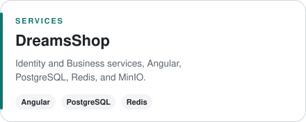

<picture>
  <source media="(prefers-color-scheme: dark)" srcset="https://capsule-render.vercel.app/api?type=waving&color=0:0B1026,45:1E1B4B,100:4338CA&height=200&section=header&text=Aliaksei%20Usov&fontSize=48&fontColor=F8FAFC&animation=fadeIn&fontAlignY=30&desc=Full-stack%20.NET%20%C2%B7%20TypeScript&descAlignY=54&descAlign=50&fontAlign=50&descSize=20" />
  <source media="(prefers-color-scheme: light)" srcset="https://capsule-render.vercel.app/api?type=waving&color=0:4338CA,40:4F46E5,100:818CF8&height=200&section=header&text=Aliaksei%20Usov&fontSize=48&fontColor=ffffff&animation=fadeIn&fontAlignY=30&desc=Full-stack%20.NET%20%C2%B7%20TypeScript&descAlignY=54&descAlign=50&fontAlign=50&descSize=20" />
  
</picture>

<picture>
  <source media="(prefers-color-scheme: dark)" srcset="https://readme-typing-svg.demolab.com?font=Inter&weight=600&size=22&duration=2800&pause=900&color=C4B5FD&center=true&vCenter=true&width=720&height=40&lines=C%23+%C2%B7+.NET+%C2%B7+ASP.NET+Core;TypeScript+%C2%B7+Next.js+%C2%B7+Angular;.NET+MAUI+%C2%B7+PostgreSQL+%C2%B7+Docker" />
  <source media="(prefers-color-scheme: light)" srcset="https://readme-typing-svg.demolab.com?font=Inter&weight=600&size=22&duration=2800&pause=900&color=3730A3&center=true&vCenter=true&width=720&height=40&lines=C%23+%C2%B7+.NET+%C2%B7+ASP.NET+Core;TypeScript+%C2%B7+Next.js+%C2%B7+Angular;.NET+MAUI+%C2%B7+PostgreSQL+%C2%B7+Docker" />
  
</picture>

<table>
<tr>
<td width="56%" valign="top">

### About

Full-stack developer and software engineering student at **BSUIR** in Minsk.

I build ASP.NET Core services, TypeScript clients, and .NET MAUI apps, and I connect them to PostgreSQL, Redis, Docker, and an observability stack when the project needs it.

</td>
<td width="44%" align="center" valign="middle">

<picture>
  <source media="(prefers-color-scheme: dark)" srcset="https://github-stats-extended.vercel.app/api?username=alrx31&show_icons=true&hide_border=true&include_all_commits=true&theme=github_dark" />
  <source media="(prefers-color-scheme: light)" srcset="https://github-stats-extended.vercel.app/api?username=alrx31&show_icons=true&hide_border=true&include_all_commits=true&theme=default" />
  
</picture>

</td>
</tr>
</table>

<table>
<tr>
<td align="center" width="33%"><b>ASP.NET Core</b> services and APIs</td>
<td align="center" width="33%"><b>TypeScript</b> Next.js and Angular</td>
<td align="center" width="34%"><b>.NET MAUI</b> Android apps</td>
</tr>
</table>

<h2 align="center">Stack</h2>

 

<h2 align="center">Selected work</h2>

<table>
<tr>
<td width="50%" align="center" valign="top">

<a href="https://github.com/alrx31/MoonDiary">
<picture>
  <source media="(prefers-color-scheme: dark)" srcset="./assets/moondiary-dark.svg" />
  
</picture>
</a>

</td>
<td width="50%" align="center" valign="top">

<a href="https://github.com/alrx31/EventPlatform">
<picture>
  <source media="(prefers-color-scheme: dark)" srcset="./assets/eventplatform-dark.svg" />
  
</picture>
</a>

</td>
</tr>
<tr>
<td width="50%" align="center" valign="top">

<a href="https://github.com/alrx31/DreamsShop">
<picture>
  <source media="(prefers-color-scheme: dark)" srcset="./assets/dreamsshop-dark.svg" />
  
</picture>
</a>

</td>
<td width="50%" align="center" valign="top">

<a href="https://github.com/alrx31/ELK-integration">
<picture>
  <source media="(prefers-color-scheme: dark)" srcset="./assets/elk-dark.svg" />
  
</picture>
</a>

</td>
</tr>
</table>

Also [LGTM-integration](https://github.com/alrx31/LGTM-integration) (Prometheus, Loki, Tempo, Grafana) and Nix [dotfiles](https://github.com/alrx31/dotfiles). Coursework in C++, Java, and databases is in the BSUIR repositories.

<h2 align="center">Activity</h2>

<table>
<tr>
<td width="50%" align="center">

<picture>
  <source media="(prefers-color-scheme: dark)" srcset="https://github-stats-extended.vercel.app/api/top-langs/?username=alrx31&layout=compact&langs_count=6&hide_border=true&card_width=340&theme=github_dark" />
  <source media="(prefers-color-scheme: light)" srcset="https://github-stats-extended.vercel.app/api/top-langs/?username=alrx31&layout=compact&langs_count=6&hide_border=true&card_width=340&theme=default" />
  
</picture>

</td>
<td width="50%" align="center">

<picture>
  <source media="(prefers-color-scheme: dark)" srcset="https://streak-stats.demolab.com?user=alrx31&theme=github-dark&hide_border=true" />
  <source media="(prefers-color-scheme: light)" srcset="https://streak-stats.demolab.com?user=alrx31&theme=default&hide_border=true" />
  
</picture>

</td>
</tr>
</table>

<h2 align="center">Contact</h2>

GitHub is the public link. Email, Telegram, and LinkedIn are placeholders.

<!-- TODO: replace Email, Telegram, and LinkedIn with real links. These TODOs are intentional. -->

<table>
<tr>
<td align="center" width="25%"><b>GitHub</b> <a href="https://github.com/alrx31">alrx31</a></td>
<td align="center" width="25%"><b>Email</b> <code>TODO</code></td>
<td align="center" width="25%"><b>Telegram</b> <code>TODO</code></td>
<td align="center" width="25%"><b>LinkedIn</b> <code>TODO</code></td>
</tr>
</table>
