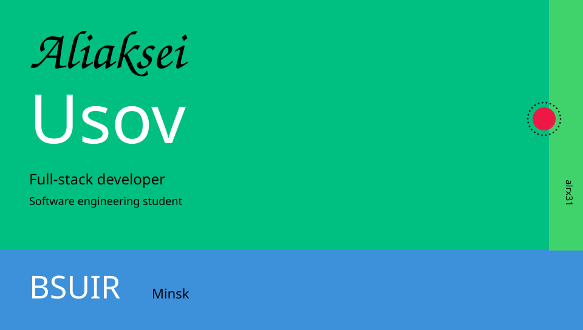
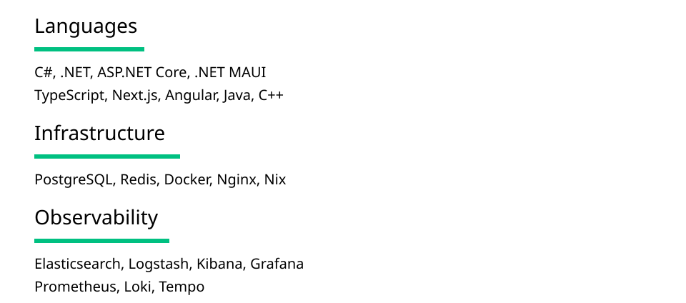
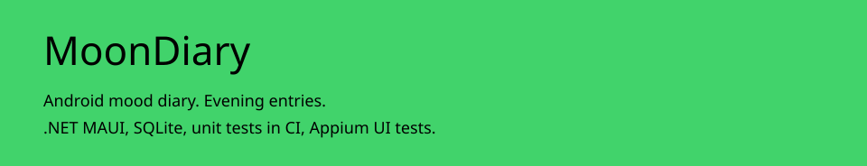

Also <a href="https://github.com/alrx31/LGTM-integration">LGTM-integration</a> (Prometheus, Loki, Tempo, Grafana) and Nix <a href="https://github.com/alrx31/dotfiles">dotfiles</a>. Coursework in C++, Java, and databases is in the BSUIR repos.

<picture>
<source media="(prefers-color-scheme: dark)" srcset="https://github-stats-extended.vercel.app/api?username=alrx31&amp;show_icons=true&amp;hide_border=true&amp;include_all_commits=true&amp;theme=github_dark">

</picture>

<picture>
<source media="(prefers-color-scheme: dark)" srcset="https://github-stats-extended.vercel.app/api/top-langs/?username=alrx31&amp;layout=compact&amp;langs_count=6&amp;hide_border=true&amp;card_width=380&amp;theme=github_dark">

</picture>
<picture>
<source media="(prefers-color-scheme: dark)" srcset="https://streak-stats.demolab.com?user=alrx31&amp;theme=github-dark&amp;hide_border=true">

</picture>

<!-- TODO: replace Email, Telegram, and LinkedIn with real links. These TODOs are intentional. -->
<a href="https://github.com/alrx31">GitHub</a> 
Email TODO 
Telegram TODO 
LinkedIn TODO

