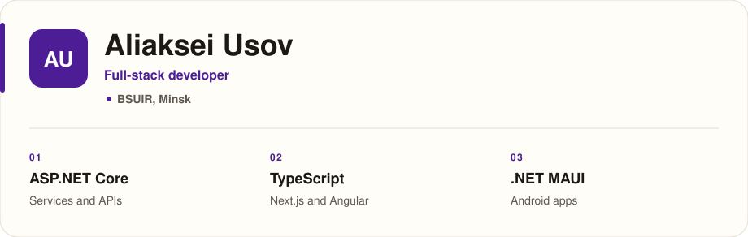
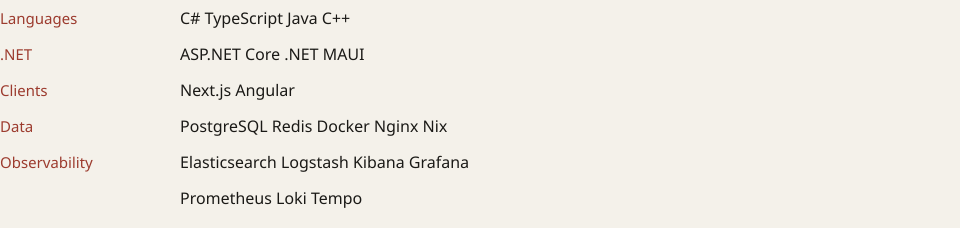
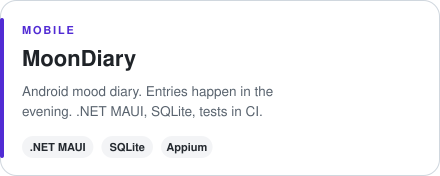
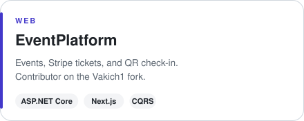
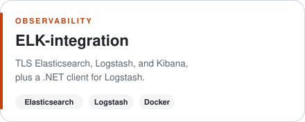

<picture>
  <source media="(prefers-color-scheme: dark)" srcset="./assets/hero-dark.svg" />
  
</picture>

<table>
<tr>
<td width="58%" valign="middle">

<picture>
  <source media="(prefers-color-scheme: dark)" srcset="./assets/about-dark.svg" />
  
</picture>

</td>
<td width="42%" align="center" valign="middle">

<picture>
  <source media="(prefers-color-scheme: dark)" srcset="https://github-stats-extended.vercel.app/api?username=alrx31&show_icons=true&hide_border=true&include_all_commits=true&theme=github_dark" />
  
</picture>

</td>
</tr>
</table>

<picture>
  <source media="(prefers-color-scheme: dark)" srcset="./assets/stack-dark.svg" />
  
</picture>

<picture>
  <source media="(prefers-color-scheme: dark)" srcset="./assets/label-work-dark.svg" />
  
</picture>

<table>
<tr>
<td width="50%" align="center">

<a href="https://github.com/alrx31/MoonDiary">
<picture>
  <source media="(prefers-color-scheme: dark)" srcset="./assets/moondiary-dark.svg" />
  
</picture>
</a>

</td>
<td width="50%" align="center">

<a href="https://github.com/alrx31/EventPlatform">
<picture>
  <source media="(prefers-color-scheme: dark)" srcset="./assets/eventplatform-dark.svg" />
  
</picture>
</a>

</td>
</tr>
<tr>
<td width="50%" align="center">

<a href="https://github.com/alrx31/DreamsShop">
<picture>
  <source media="(prefers-color-scheme: dark)" srcset="./assets/dreamsshop-dark.svg" />
  
</picture>
</a>

</td>
<td width="50%" align="center">

<a href="https://github.com/alrx31/ELK-integration">
<picture>
  <source media="(prefers-color-scheme: dark)" srcset="./assets/elk-dark.svg" />
  
</picture>
</a>

</td>
</tr>
</table>

Also <a href="https://github.com/alrx31/LGTM-integration">LGTM-integration</a> (Prometheus, Loki, Tempo, Grafana) and Nix <a href="https://github.com/alrx31/dotfiles">dotfiles</a>. Coursework in C++, Java, and databases is in the BSUIR repositories.

<picture>
  <source media="(prefers-color-scheme: dark)" srcset="./assets/label-activity-dark.svg" />
  
</picture>

<table>
<tr>
<td width="46%" align="center" valign="middle">

<picture>
  <source media="(prefers-color-scheme: dark)" srcset="https://github-stats-extended.vercel.app/api/top-langs/?username=alrx31&layout=compact&langs_count=6&hide_border=true&card_width=380&theme=github_dark" />
  
</picture>

</td>
<td width="54%" align="center" valign="middle">

<picture>
  <source media="(prefers-color-scheme: dark)" srcset="https://streak-stats.demolab.com?user=alrx31&theme=github-dark&hide_border=true" />
  
</picture>

</td>
</tr>
</table>

<picture>
  <source media="(prefers-color-scheme: dark)" srcset="./assets/label-contact-dark.svg" />
  
</picture>

GitHub is the public link. Email, Telegram, and LinkedIn are placeholders.

<!-- TODO: replace Email, Telegram, and LinkedIn with real links. These TODOs are intentional. -->

<table>
<tr>
<td align="center" width="25%"><b>GitHub</b> <a href="https://github.com/alrx31">alrx31</a></td>
<td align="center" width="25%"><b>Email</b> <code>TODO</code></td>
<td align="center" width="25%"><b>Telegram</b> <code>TODO</code></td>
<td align="center" width="25%"><b>LinkedIn</b> <code>TODO</code></td>
</tr>
</table>
