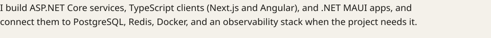

<picture>
  <source media="(prefers-color-scheme: dark)" srcset="./assets/hero-dark.svg" />
  
</picture>

<picture>
  <source media="(prefers-color-scheme: dark)" srcset="./assets/about-dark.svg" />
  
</picture>

<picture>
  <source media="(prefers-color-scheme: dark)" srcset="./assets/stack-dark.svg" />
  
</picture>

<picture>
  <source media="(prefers-color-scheme: dark)" srcset="https://github-stats-extended.vercel.app/api?username=alrx31&amp;show_icons=true&amp;hide_border=true&amp;include_all_commits=true&amp;theme=github_dark" />
  
</picture>

<picture>
  <source media="(prefers-color-scheme: dark)" srcset="https://github-stats-extended.vercel.app/api/top-langs/?username=alrx31&amp;layout=compact&amp;langs_count=6&amp;hide_border=true&amp;card_width=380&amp;theme=github_dark" />
  
</picture>

<picture>
  <source media="(prefers-color-scheme: dark)" srcset="https://streak-stats.demolab.com?user=alrx31&amp;theme=github-dark&amp;hide_border=true" />
  
</picture>

<!-- TODO: replace Email, Telegram, and LinkedIn with real links. These TODOs are intentional. -->

<a href="https://github.com/alrx31">GitHub</a> 
Email TODO 
Telegram TODO 
LinkedIn TODO

